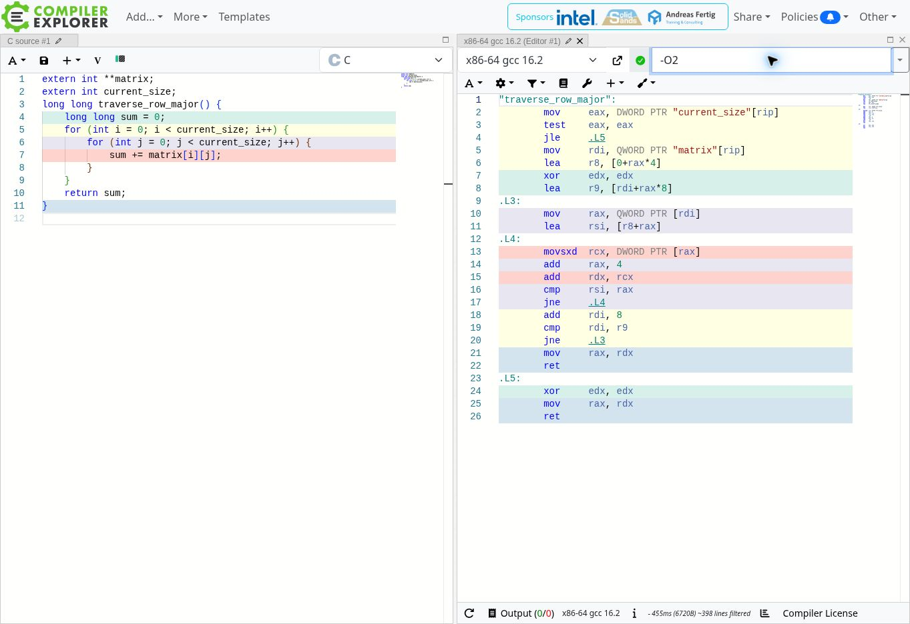
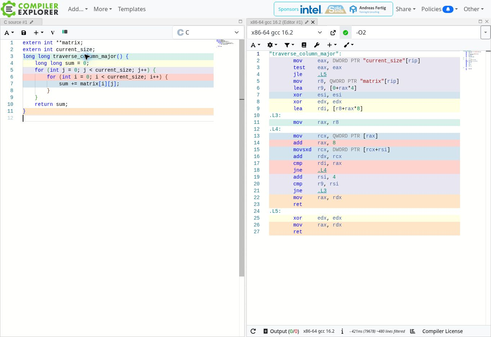

# Cache Behavior Lab Analysis

## Section 1: Performance Measurements

Measurements were collected in the provided remote Linux environment, **not on my personal Mac**: x86-64 Intel Xeon Platinum 8573C, Ubuntu, GCC 13.3.0. The starter timing uses `clock()` (process CPU time) and excludes allocation/initialization. Each optimization level was run three times; the tables show the median time for each traversal, in milliseconds. Ratios are column median divided by row median, calculated from the displayed times. Full trial output is in [measurements.txt](measurements.txt).

The unoptimized baseline (`gcc cache_lab.c -o cache_lab`, equivalent to `-O0` here) is:

| Matrix size | Row-major (ms) | Column-major (ms) | Column / row |
|---|---:|---:|---:|
| 1000 × 1000 | 1.98 | 2.70 | 1.36× |
| 2000 × 2000 | 8.08 | 13.38 | 1.66× |
| 4000 × 4000 | 32.43 | 77.81 | 2.40× |
| 8000 × 8000 | 125.89 | 421.01 | 3.34× |

Both sums matched in every run: 49,500,000; 198,000,000; 792,000,000; and 3,168,000,000. The `long long` accumulator is necessary because the largest sum exceeds a signed 32-bit integer.

## Section 2: Optimization Level Comparison

| Optimization | Matrix size | Row-major (ms) | Column-major (ms) | Column / row |
|---|---|---:|---:|---:|
| `-O0` | 1000 × 1000 | 1.98 | 2.70 | 1.36× |
| `-O0` | 2000 × 2000 | 8.08 | 13.38 | 1.66× |
| `-O0` | 4000 × 4000 | 32.43 | 77.81 | 2.40× |
| `-O0` | 8000 × 8000 | 125.89 | 421.01 | 3.34× |
| `-O2` | 1000 × 1000 | 0.55 | 1.24 | 2.25× |
| `-O2` | 2000 × 2000 | 2.53 | 5.88 | 2.32× |
| `-O2` | 4000 × 4000 | 10.46 | 87.25 | 8.34× |
| `-O2` | 8000 × 8000 | 44.87 | 479.50 | 10.69× |
| `-O3` | 1000 × 1000 | 0.68 | 1.43 | 2.10× |
| `-O3` | 2000 × 2000 | 2.06 | 6.89 | 3.34× |
| `-O3` | 4000 × 4000 | 8.55 | 94.33 | 11.03× |
| `-O3` | 8000 × 8000 | 41.50 | 490.58 | 11.82× |

`-O3` does not eliminate the gap: at 8000 × 8000, column-major remains about 11.82 times slower. Optimization reduces instruction overhead and can improve row-major processing, but this compiler keeps the column-first access pattern and its poor locality. Removing loop overhead does not remove the cost of fetching scattered data.

Reproduce with:

```sh
gcc cache_lab.c -o cache_lab
./cache_lab
gcc -O0 cache_lab.c -o cache_O0 && ./cache_O0
gcc -O2 cache_lab.c -o cache_O2 && ./cache_O2
gcc -O3 cache_lab.c -o cache_O3 && ./cache_O3
```

These are small, controlled measurements, not universal speed guarantees. The starter always runs row-major first, does not flush caches, and times one traversal per size per execution. Shared-machine load, cache state, allocation addresses, and timing resolution introduce variation; medians reduce but do not eliminate that variation.

## Section 3: Assembly Analysis

The following are actual Compiler Explorer screenshots using **C, x86-64 GCC 16.2, `-O2`**. Each function was pasted with `extern int **matrix;` and `extern int current_size;` so it could compile independently. Compiler Explorer's compiler version differs from the local GCC 13.3.0 used for the timing tables; [cache_O2.s](cache_O2.s) also preserves assembly from the measured local build.

### Row-major assembly



### Column-major assembly



The overall instruction structure is similar: nested loops, integer loads, additions, comparisons, and branches. There is no radically different computational algorithm, but the addressing instructions are meaningfully different. Row-major loads one row pointer for an entire inner loop; its inner loop contains `movsxd rcx, DWORD PTR [rax]` and `add rax, 4`, which advances to the next integer. Column-major contains `mov rcx, QWORD PTR [rax]`, `add rax, 8`, and `movsxd rcx, DWORD PTR [rcx+rsi]`: it advances through 8-byte row pointers, then loads an integer at the fixed column offset in each row.

Thus, similar instruction counts can have very different execution times because a load's latency depends on where its data resides in the memory hierarchy. The assembly supports an explanation based on locality and extra pointer loads rather than extra arithmetic. It does not by itself prove a particular cache-miss rate.

## Section 4: Cache Behavior Explanation

C stores a true two-dimensional array in row-major order. The elements in one row are next to each other, and the next row follows that row in the same allocation. The starter program uses an int** instead: it allocates a table of row pointers, then allocates each row separately. Each individual row is contiguous, but separate rows are not guaranteed to be adjacent. Therefore, moving across columns within one row still follows consecutive integers. Both traversal functions visit every element once, add the same values, and have O(N²) time complexity. However, that complexity does not describe the cost of retrieving those values from memory.

A CPU transfers memory in cache lines rather than fetching only the requested integer. On this x86 system, a typical 64-byte cache line holds sixteen 4-byte integers, assuming alignment. When row-major traversal reads one integer, nearby integers arrive with it. The next iterations can use those cached neighbors immediately, and hardware prefetching can recognize the sequential stream. Column-major traversal instead reads one integer from each row before returning to the next integer of the first row. It initially uses only a small part of each fetched line, and revisits that line after thousands of other accesses. The lines may be evicted from a smaller cache before that reuse occurs, although some requests can still hit in larger caches. Row-pointer loads, address translation, and the number of simultaneous memory streams also affect this version. Larger matrices increase the pressure on caches and translation resources, helping explain the widening measured gap.

Compiler optimization reduces loop bookkeeping and may enable vectorization, but it does not automatically reorganize the separately allocated rows or guarantee a better access order. In these builds, the optimized column-major function retains its column-first traversal, so faster arithmetic cannot remove the memory-access cost. A compiler can sometimes interchange loops when it proves the transformation is legal and worthwhile; saying that compilers can never fix this would be too strong. Here, manually choosing row-first loops makes the intended locality explicit. The timings and assembly are consistent with a memory-locality explanation, but timing alone does not directly measure cache misses. Hardware performance counters would be needed to quantify those misses.

### Connection to my final project

My final project is a C program that searches synthetic golfer profiles to find nearby players with compatible skill ratings and availability. I plan to keep the frequently searched fields in contiguous arrays and scan them sequentially instead of following linked nodes scattered through memory. I will compare an array of compact profiles with separate arrays for fields such as location, skill rating, and availability to see which layout helps the actual search workload. I will benchmark the baseline and optimized versions on the same inputs and verify identical matches before deciding whether the changes improve performance.
